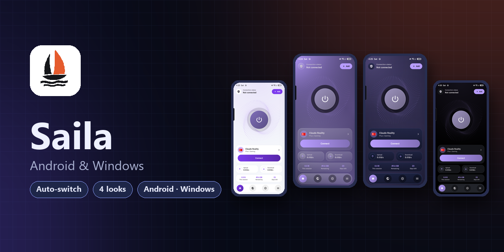
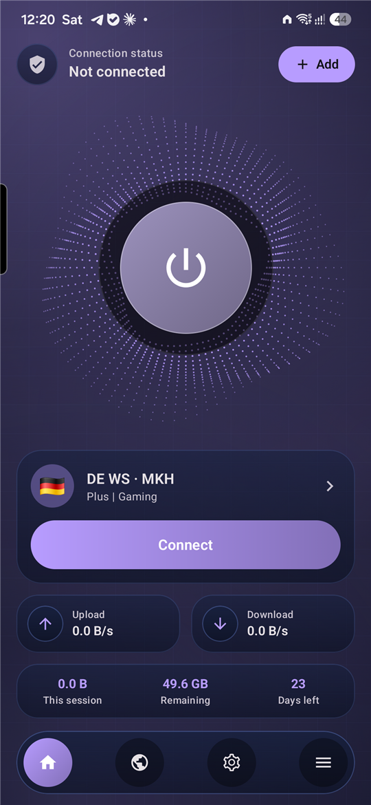
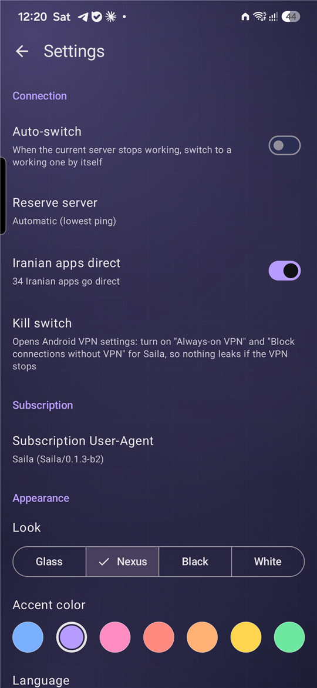
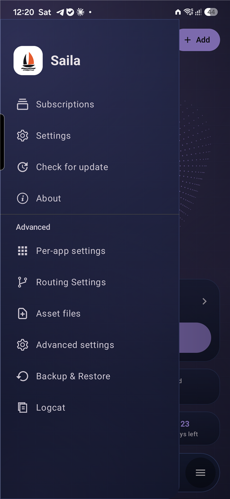

<div dir="rtl">

<p align="center">
  
</p>

<h1 align="center">Saila</h1>

<p align="center">
  یک کلاینت VPN ساده برای اندروید و ویندوز که شما را وصل نگه می‌دارد.<br>
  <a href="README.md">English</a> · <a href="https://plus98ir.github.io/Saila/">وب‌سایت</a> · <a href="https://github.com/Plus98ir/Saila/releases/latest">اندروید</a> · <a href="https://github.com/Plus98ir/Saila-Windows/releases/latest">ویندوز</a>
</p>

---

Saila یک کلاینت VPN برای اندروید است که با هسته‌ی Xray کار می‌کند. لینک اشتراک خود را یک بار اضافه کنید؛ Saila یک سرور سالم انتخاب می‌کند، اگر از کار افتاد خودش سوییچ می‌کند و مزاحم شما نمی‌شود.

<p align="center">
  
  
  
</p>

## قابلیت‌ها

- **یک دکمه‌ی بزرگ اتصال**، تایمر اتصال، سرعت لحظه‌ای آپلود و دانلود و حجم مصرفی همین اتصال.
- **سوییچ خودکار**: هر ۱۰ ثانیه اتصال را چک می‌کند و اگر قطع شد به سرور رزرو می‌رود (خودکار با کمترین پینگ، یا سروری که خودتان انتخاب کنید).
- **اطلاعات اشتراک**: حجم و روزهای باقی‌مانده از پنل شما.
- **پرچم کشور** برای هر سرور: از اسم کانفیگ یا از روی آدرس سرور.
- **اپ‌های ایرانی مستقیم**: بانک‌ها، دیوار، اسنپ و دیگر اپ‌های ایرانی خودکار پیدا می‌شوند و بدون VPN وصل می‌شوند.
- **MASQUE و XDRIVE**: کانفیگ‌های این دو از اشتراک JSON پنل‌های 3X-UI خودکار اضافه می‌شوند.
- **ظاهر**: شیشه‌ای، Nexus، مشکی و سفید، با هفت رنگ اصلی. فارسی و انگلیسی.
- میان‌بر **Kill switch**، User-Agent قابل تنظیم برای اشتراک و اعلان نسخه‌ی جدید داخل اپ.
- همه‌ی تنظیمات فنی (مسیریابی، DNS، هسته) در بخش *پیشرفته* در دسترس است.

## دانلود

آخرین APK را از [Releases](https://github.com/Plus98ir/Saila/releases/latest) بگیرید:

| فایل | برای |
|---|---|
| `Saila_<نسخه>_arm64-v8a.apk` | بیشتر گوشی‌های چند سال اخیر |
| `Saila_<نسخه>_armeabi-v7a.apk` | گوشی‌های قدیمی ۳۲ بیتی |
| `Saila_<نسخه>_universal.apk` | مطمئن نیستید؟ این روی همه نصب می‌شود (حجم بیشتر) |
| `Saila_<نسخه>_x86_64.apk` / `x86` | شبیه‌سازها و تبلت‌های اینتل/AMD |

خود اپ نسخه‌ی جدید را پیدا می‌کند و فایل مناسب گوشی شما را پیشنهاد می‌دهد.

**ویندوز:** [Saila برای ویندوز](https://github.com/Plus98ir/Saila-Windows/releases/latest) — فایل `Saila-windows-64.zip` را باز کنید و `Saila.exe` را اجرا کنید.

## ساختن از سورس

نیازها: JDK 21، Android SDK (compile SDK 37)، فایل `libv2ray.aar` از [AndroidLibXrayLite](https://github.com/2dust/AndroidLibXrayLite/releases) و کتابخانه‌های `hev-socks5-tunnel` در `V2rayNG/app/libs`.

<div dir="ltr">

```sh
cd V2rayNG
./gradlew assemblePlaystoreRelease -Pandroid.injected.build.abi=arm64-v8a
```

</div>

امضای نسخه‌ی release از `keystore.properties` خوانده می‌شود (مسیرش در `SAILA_KEYSTORE_PROPERTIES`)؛ بدون آن خروجی امضا نمی‌شود.

## سپاس و لایسنس

Saila بر پایه‌ی [v2rayNG](https://github.com/2dust/v2rayNG) ساخته‌ی 2dust است و از [Xray-core](https://github.com/XTLS/Xray-core) استفاده می‌کند. از هر دو پروژه سپاسگزاریم.

تحت لایسنس [GNU General Public License v3.0](LICENSE)، مثل v2rayNG.

</div>
