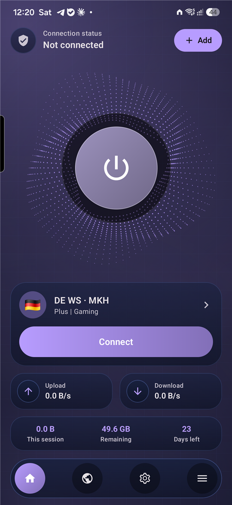
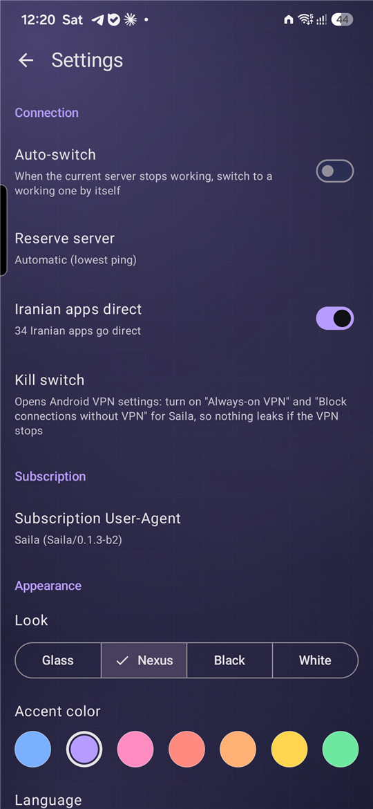
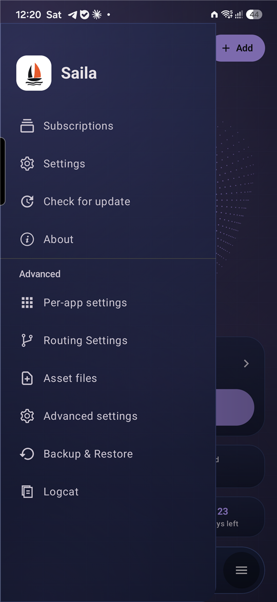

<p align="center">
  
</p>

<h1 align="center">Saila</h1>

<p align="center">
  A simple Android VPN client that keeps you connected.<br>
  <a href="README.fa.md">فارسی</a> · <a href="https://plus98ir.github.io/Saila/">Website</a> · <a href="https://github.com/Plus98ir/Saila/releases/latest">Download</a>
</p>

---

Saila is an Xray-based VPN client for Android. Add your subscription link once; Saila picks a working server, switches by itself when one stops working, and stays out of your way.

<p align="center">
  
  
  
</p>

## Features

- **One big connect button**, connection timer, live upload/download and this session's traffic.
- **Auto-switch**: checks the connection every 30 seconds; if it drops, moves to a reserve server (automatic lowest ping, or one you choose).
- **Subscription info**: remaining traffic and days, read from your panel.
- **Country flags** for servers: from the name, or looked up from the server address.
- **Iranian apps direct**: banks, Divar, Snapp and other Iranian apps are detected and bypass the VPN.
- **MASQUE and XDRIVE** configs from 3X-UI panels are imported from the panel's JSON subscription automatically.
- **Looks**: Glass, Nexus, Black and White, with seven accent colors. Persian and English.
- **Kill switch** shortcut, configurable subscription User-Agent, update notice inside the app.
- Everything technical (routing, DNS, core settings) stays available under *Advanced*.

## Download

Get the latest APK from [Releases](https://github.com/Plus98ir/Saila/releases/latest). Most phones need the `arm64-v8a` build.

## Build

Requirements: JDK 21, Android SDK (compile SDK 37), `libv2ray.aar` from [AndroidLibXrayLite](https://github.com/2dust/AndroidLibXrayLite/releases) and the `hev-socks5-tunnel` libraries in `V2rayNG/app/libs`.

```sh
cd V2rayNG
./gradlew assemblePlaystoreRelease -Pandroid.injected.build.abi=arm64-v8a
```

Release signing reads `keystore.properties` (path in `SAILA_KEYSTORE_PROPERTIES`); without it the build is unsigned.

## Credits and license

Saila is based on [v2rayNG](https://github.com/2dust/v2rayNG) by 2dust and uses [Xray-core](https://github.com/XTLS/Xray-core). Many thanks to both projects.

Licensed under the [GNU General Public License v3.0](LICENSE), like v2rayNG.
